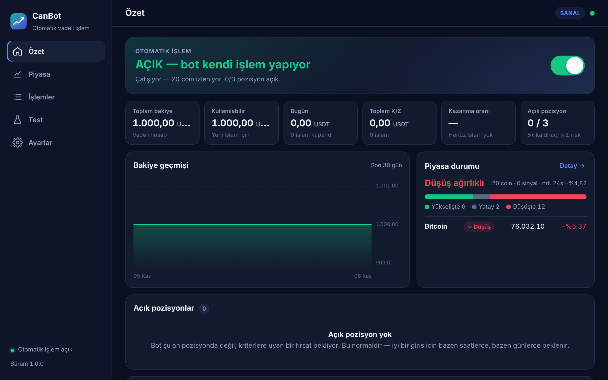
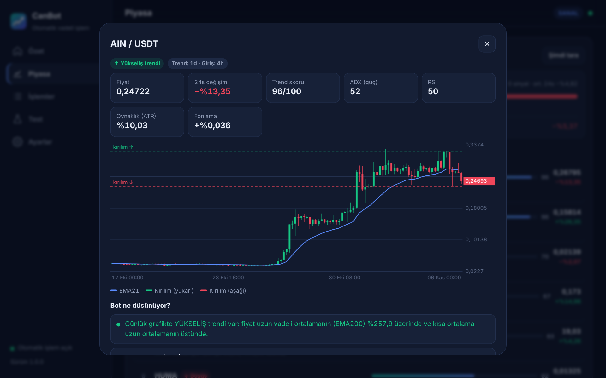
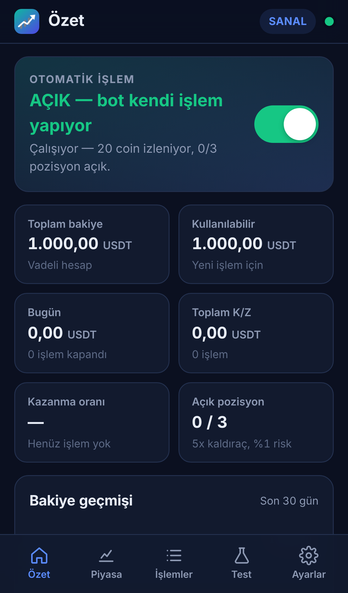

# CanBot — Binance Vadeli İşlemler için Otomatik İşlem Botu

CanBot, Binance **USDⓈ-M vadeli işlemler** (kaldıraçlı) piyasasını sizin yerinize sürekli tarar, **güçlü trendi olan coinleri bulur**, kurallara uyan fırsatlarda **kendi kendine pozisyon açar**, stop-loss koyar, kârı iz süren stop ile korur ve pozisyonu kapatır. Siz bilgisayarda çalışırken program saatin yanındaki simgede arka planda çalışır; **iPhone'dan** da takip edip kontrol edebilirsiniz.



| Coin analizi | iPhone |
|---|---|
|  |  |

---

## ⚠️ Önce bunu okuyun

- **Hiçbir bot kâr garantisi veremez.** “En çok kazandıracak coini” önceden kimse bilemez. CanBot, geçmişte işe yaramış disiplinli bir kural setini (trend takibi) uygular ve riski sınırlar — o kadar.
- Kaldıraçlı işlemlerde **kısa sürede büyük kayıp** yaşanabilir. Kaybetmeyi göze alamayacağınız parayla kullanmayın.
- Önce **Sanal** modda (para riske girmeden, gerçek fiyatlarla) en az birkaç hafta çalıştırın, sonra küçük bir tutarla gerçek moda geçin.
- Bot her işleme **Binance tarafında stop-loss** koyar; bilgisayarınız kapansa veya internet gitse bile koruma borsada durur. Stop konulamazsa pozisyonu hemen kapatır.
- Önerilen en düşük bakiye **~200 USDT**'dir. Daha küçük bakiyede bazı büyük coinler (ör. BTC) Binance'in en düşük emir tutarı yüzünden atlanır.

## Nasıl çalışır?

1. **Coin seçimi:** Binance vadeli piyasasında hacmi en yüksek (en likit) 20 coin taranır. Çok yeni listelenen coinler ve stabil coinler atlanır.
2. **Trend analizi (günlük grafik):** Fiyat 200 günlük ortalamanın üstünde, kısa ortalama uzun ortalamanın üstünde ve yükseliyorsa **yükseliş**, tersi ise **düşüş** trendi. Trendin gücü ADX, fiyatın düzenliliği ve yön baskınlığıyla **0–100 arası skorlanır.** En yüksek skorlu coinler öne alınır.
3. **Giriş (4 saatlik grafik):** Yükseliş trendindeki coin son 20 mumun zirvesini kırarsa **long (AL)**, düşüş trendindeki coin son 20 mumun dibini kırarsa **short (SAT)**.
4. **Risk:** Her işlemde stop olursa bakiyenin en fazla **%1**'i kaybedilir (ayarlanabilir). Pozisyon büyüklüğü buna göre hesaplanır; stop, tasfiye fiyatından her zaman çok önce olacak şekilde kaldıraç gerekirse otomatik düşürülür.
5. **Çıkış:** Fiyat lehe gittikçe stop arkadan gelir (**iz süren stop**, 3×ATR). Trend dönerse pozisyon kapatılır.
6. **Koruma:** Günlük zarar %5'e ulaşırsa o gün yeni işlem açılmaz; bakiye zirveden %25 düşerse bot kendini durdurur.

Panelde her coin için grafik ve **“Bot ne düşünüyor?”** bölümünde sade Türkçe açıklama görürsünüz (trend var mı, ne kadar güçlü, giriş için ne bekleniyor, fonlama oranı normal mi…).

## Test sonuçları (dürüst özet)

Strateji, 20 büyük coinin **Temmuz 2022 – Ekim 2026** arası gerçek Binance verisinde; %0,05 komisyon ve kayma dahil, işlem başı %1 riskle denendi. Ayarlar yalnızca ilk dönemde seçildi, ikinci dönem stratejinin hiç görmediği veridir:

| Dönem | Getiri | En büyük düşüş | İşlem | Kazanma oranı | Kâr faktörü |
|---|---|---|---|---|---|
| Tem 2022 – Haz 2024 (ayar dönemi) | +%15,9 | %16,1 | 208 | %34 | 1,18 |
| Tem 2024 – Eki 2026 (görülmemiş veri) | +%65,3 | %17,3 | 262 | %41 | 1,42 |
| **Son 12 ay** (Kas 2025 – Eki 2026) | **+%6,5** | %16,2 | 131 | %36 | 1,10 |

- İşlemlerin çoğu (≈%60) **zararla** kapanır; kâr, az sayıdaki büyük kazançtan gelir. Arka arkaya 10+ kayıp normaldir.
- Daha kısa zaman dilimleri (15 dk, 1 saat) aynı testlerde **zarar etti**; bu yüzden varsayılanlar günlük/4 saatliktir.
- Riski iki katına (%2) çıkarmak en büyük düşüşü **%17'den %32'ye** çıkardı, son 12 aydaki getiriyi ise neredeyse hiç artırmadı.
- Fonlama ücretleri teste dahil değildir (canlı modda hesaplanır). Coinler bugünkü hacme göre seçildiği için sonuçlar biraz iyimser olabilir.
- **Geçmiş sonuçlar geleceği garanti etmez.** Panelin **Test** sekmesinden kendi ayarlarınızla güncel veride tekrar deneyebilirsiniz.

---

## Kurulum (Windows)

### Yol 1 — Hazır program (önerilen)

1. GitHub'da bu deponun **Actions** sekmesini açın → **“Test ve Windows uygulaması”** → en üstteki yeşil (✓) çalışmaya tıklayın.
2. Sayfanın altındaki **Artifacts** bölümünden **CanBot-Windows**'u indirin ve zip'i açın.
3. **CanBot-Kurulum.exe**'yi çalıştırın (Başlat menüsüne ve masaüstüne kısayol ekler). İsterseniz kurulumsuz **CanBot.exe**'yi doğrudan da açabilirsiniz.
4. Windows “**Bilgisayarınız korundu**” derse: **Ek bilgi → Yine de çalıştır** (program imzasız olduğu için bu uyarı çıkar).
5. Windows Güvenlik Duvarı sorarsa **İzin ver** deyin (yalnızca telefondan bağlanmak için gerekir).

### Yol 2 — Kaynak koddan

1. [python.org](https://www.python.org/downloads/)'dan Python 3.11+ kurun (“Add python.exe to PATH” kutusunu işaretleyin).
2. Bu depoyu **Code → Download ZIP** ile indirip açın.
3. **Kurulum.bat**'a çift tıklayın. Gerekli paketleri kurar, masaüstüne **CanBot** kısayolu ekler ve programı açar.

Her iki yolda da program **siyah konsol penceresi olmadan**, kendi penceresinde açılır. Pencereyi kapatınca bot **saatin yanındaki simgede** çalışmaya devam eder (sağ tık → Paneli aç / Otomatik işlem / Çıkış).

### Yol 3 — Ubuntu sunucu (VPS), 7/24

Windows penceresi yerine sunucu modunda çalışır; aynı paneli tarayıcıdan ve telefondan kullanırsınız. Ubuntu 22.04 / 24.04'te çalışır. Kurulum betiği (`kurulum-ubuntu.sh`) CanBot'u `/opt/canbot` klasörüne kurar, sunucu yeniden başlasa da açılan bir hizmet olarak 7/24 çalıştırır ve sonunda sunucunun internet IP'sini (Binance anahtarının IP listesi için) ve Binance'e erişim durumunu yazar. Bu depo gizli (private) olduğu için kodu sunucuya iki yoldan birini kullanarak alırsınız:

**A) GitHub token ile (önerilen):** GitHub'da **Settings → Developer settings → Personal access tokens → Fine-grained tokens → Generate new token**; *Repository access*: yalnızca bu depo, *Permissions → Contents*: **Read-only**. Sonra sunucuda (SSH ile bağlanıp):

```bash
TOKEN=github_pat_BURAYA_TOKEN
curl -fsSL -H "Authorization: Bearer $TOKEN" -H "Accept: application/vnd.github.raw" \
  "https://api.github.com/repos/g2w4ypjjrp-lang/Can/contents/kurulum-ubuntu.sh?ref=claude/merhaba-fpsls2" -o kurulum-ubuntu.sh
sudo GH_TOKEN=$TOKEN bash kurulum-ubuntu.sh
```

**B) ZIP ile:** GitHub'da bu dalı **Code → Download ZIP** ile indirin, WinSCP gibi bir programla sunucuya yükleyin, sonra:

```bash
sudo apt install -y unzip && unzip Can-claude-merhaba-fpsls2.zip
sudo bash Can-claude-merhaba-fpsls2/kurulum-ubuntu.sh
```

Güncellemek için aynı komutları tekrar çalıştırın; ayarlarınız, anahtarlarınız ve kayıtlarınız korunur.

Güvenlik için panel internete açılmaz, yalnızca sunucunun içinden erişilir. Bilgisayardan bağlanmak için Windows'ta PowerShell'de `ssh -L 8765:127.0.0.1:8765 kullanıcı@SUNUCU_IP` yazın; bu pencere açıkken tarayıcıda `http://localhost:8765` adresini açın. Telefondan bağlanmak için kurulumun sonunda yazan Tailscale adımlarını izleyin.

## İlk açılış

Kurulum sihirbazı sizi 4 adımda yönlendirir:

1. Kısa bilgilendirme ve risk uyarısı
2. **Sanal hesapla dene** (önerilen) ya da **Binance hesabımı bağla**
3. Risk seviyesi: Temkinli (%0,5) · **Dengeli (%1, önerilen)** · Atak (%2)
4. Otomatik işlemi başlat

Sonra **Ayarlar → Windows** bölümünden “**Windows açılınca başlat**” ve “**Bilgisayarı uyanık tut**” seçeneklerini açabilirsiniz. Böylece bilgisayar açıkken bot hep çalışır. Dizüstü bilgisayarda kapak kapanınca uykuya geçmemesi için Windows **Güç seçenekleri**'nden “Kapağı kapattığımda: Hiçbir şey yapma” ayarını seçin.

## Binance API anahtarı nasıl alınır?

**Ön koşullar** (Binance'in kuralı): kimlik doğrulaması tamamlanmış, iki aşamalı doğrulama (2FA) açık ve Spot cüzdana en az bir kez para yatırılmış olmalı. **Vadeli (Futures) hesabını anahtardan ÖNCE açın**; vadeli hesaptan önce oluşturulan anahtara Vadeli izni verilemez (o durumda yeni anahtar oluşturun).

1. **API Yönetimi'ne gidin.**
   - Bilgisayarda (binance.com): sağ üstteki **profil simgesi → Hesap → API Yönetimi**
   - Telefonda: uygulamayı **Binance Pro** moduna alın → **Daha fazla (More)** → **Diğer (Other)** bölümü → **API Yönetimi**
2. **API Oluştur** → **Sistem tarafından oluşturulan** (System generated) seçin. CanBot bu türü kullanır.
3. İsim verin (ör. *CanBot*) ve güvenlik doğrulamasını tamamlayın.
4. Çıkan **API Key** ve **Secret Key**'i hemen kopyalayın. Secret Key sonra tekrar gösterilmez.
5. **Kısıtlamaları düzenle**:
   - IP erişimi: **Yalnızca güvenilir IP'lere erişimi kısıtla** seçin ve internet IP adresinizi ekleyin (Google'da “IP adresim” yazınca görünür). **Bu adım zorunludur:** Binance, IP kısıtlaması olmayan bu tür anahtarlara yalnızca okuma izni verir; bot işlem yapamaz.
   - **Okumayı Etkinleştir** ve **Vadeli İşlemleri Etkinleştir** kutularını işaretleyip kaydedin.
   - **Para çekme iznini ASLA açmayın.** Bot buna ihtiyaç duymaz; CanBot bu izin açıksa sizi uyarır.
6. CanBot'ta **Ayarlar → Binance API anahtarları → Gerçek hesap**'a yapıştırıp **Kaydet** ve **Bağlantıyı test et**'e basın.
7. Binance'te **Cüzdan → Aktar** ile USDT'yi Spot'tan **USDⓈ-M Vadeli** cüzdana aktarın.

Notlar:
- İnternet IP adresiniz değişirse (modem yeniden başlayınca değişebilir) bot işlem yapamaz ve panelde hata görürsünüz. Binance'te API Yönetimi'nden yeni IP'yi ekleyin. Açık pozisyonların stop-loss'ları bu sırada borsada durur.
- **Binance TR** (trbinance) vadeli işlem sunmaz; bot Binance (global) vadeli hesabıyla çalışır. Ülkenizde/hesabınızda vadeli işlemlere izin olduğundan emin olun.
- Testnet için anahtarları Binance **Demo Trading** sayfasından alıp “Testnet” sekmesine girin.
- Anahtarlar yalnızca bilgisayarınızda (`%LOCALAPPDATA%\CanBot\secrets.json`) saklanır ve yalnızca Binance'e gönderilir.

## iPhone'dan kullanım

1. iPhone ile bilgisayar **aynı Wi-Fi**'de olsun.
2. Panelde **Ayarlar → Telefon** bölümünden bir **şifre** belirleyin.
3. iPhone kamerasıyla aynı bölümdeki **QR kodu** okutun (ya da Safari'de gösterilen adresi açın).
4. Safari'de **Paylaş → Ana Ekrana Ekle**. CanBot artık telefonunuzda uygulama gibi açılır.

Evden uzaktayken bağlanmak isterseniz [Tailscale](https://tailscale.com/) gibi ücretsiz, güvenli bir VPN kullanın. Botu modem ayarlarıyla internete doğrudan açmayın.

## Sık sorulan sorular

**Bot neden hiç işlem açmıyor?** Bot yalnızca kurallara uyan fırsatlarda girer; bu bazen saatler, bazen günler sürer. Kontroller her 4 saatlik mum kapanışında (TSİ 03:00, 07:00, 11:00, 15:00, 19:00, 23:00) yapılır. **Piyasa** sekmesinde her coin için neyin beklendiğini görebilirsiniz.

**Bilgisayar kapanırsa ne olur?** Açık pozisyonların stop-loss emirleri Binance'te durur, yani korunursunuz. Ancak yeni işlem açılmaz ve iz süren stop güncellenmez. Bot açılınca kaldığı yerden devam eder.

**Elle açtığım pozisyonlara dokunur mu?** Hayır. Botun açmadığı pozisyonlar ayrıca listelenir; bot o coinlerde işlem açmaz.

**Botu iki bilgisayarda aynı anda çalıştırabilir miyim?** Aynı API anahtarıyla hayır — iki bot aynı hesapta birbirinden habersiz işlem açar. Tek bilgisayarda çalıştırıp diğer cihazlardan (telefon gibi) panele bağlanın.

**Telegram bildirimi alabilir miyim?** Evet: **Ayarlar → Telegram** (isteğe bağlı).

**Verilerim nerede?** `%LOCALAPPDATA%\CanBot` (ayarlar, işlem geçmişi, günlük dosyaları). Kaynak koddan çalıştırırken proje içindeki `data` klasörü.

---

## Geliştiriciler için

```bash
python -m venv .venv && . .venv/bin/activate      # Windows: .venv\Scripts\activate
pip install -r requirements.txt -r requirements-dev.txt
python run.py                       # sunucu modu: http://localhost:8765 (macOS / Linux / VPS)
python -m bot.desktop               # masaüstü modu (requirements-desktop.txt gerekir)
python -m bot.backtest --days 180 --symbols 20   # komut satırından geçmiş testi
python -m pytest -q                 # testler
```

| Klasör / dosya | Görev |
|---|---|
| `bot/strategy.py` | Trend analizi, skor, giriş sinyali, iz süren stop |
| `bot/risk.py` | Pozisyon büyüklüğü, güvenli kaldıraç, günlük/düşüş limitleri |
| `bot/engine.py` | Tarama döngüsü, işlem açma/yönetme, panel komutları, coin analizi |
| `bot/brokers.py` | Sanal hesap ve Binance (testnet/gerçek) emir katmanı |
| `bot/binance_client.py` | İmzalı Binance USDⓈ-M REST istemcisi (Algo Order dahil) |
| `bot/backtest.py` | Geçmiş testi (canlı botla aynı strateji kodu) |
| `bot/web/` | FastAPI sunucusu ve panel (PWA) |
| `bot/desktop.py` | Windows penceresi, tepsi simgesi, otomatik başlatma |
| `packaging/` | PyInstaller (CanBot.exe) ve Inno Setup (kurulum) dosyaları |

Windows programı her `push`'ta GitHub Actions tarafından üretilir ve paketlenmiş uygulama, pencere açmadan kendi kendini test eder (`--selftest`).
